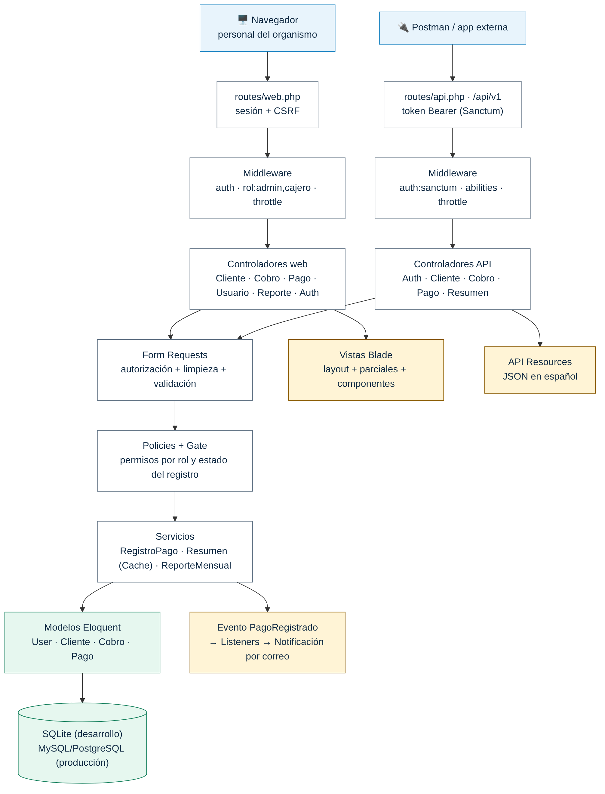
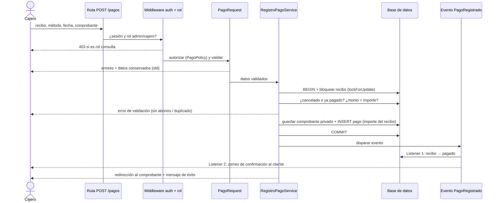
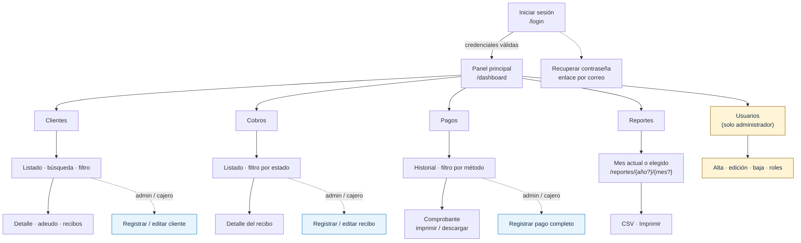
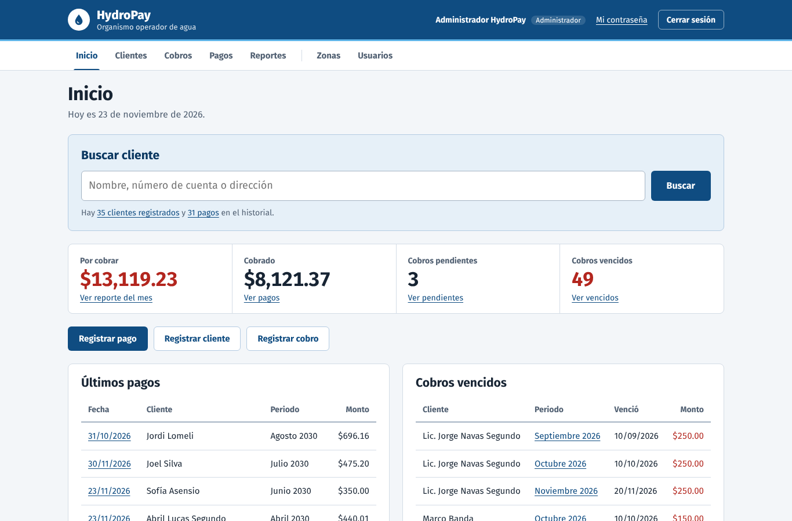
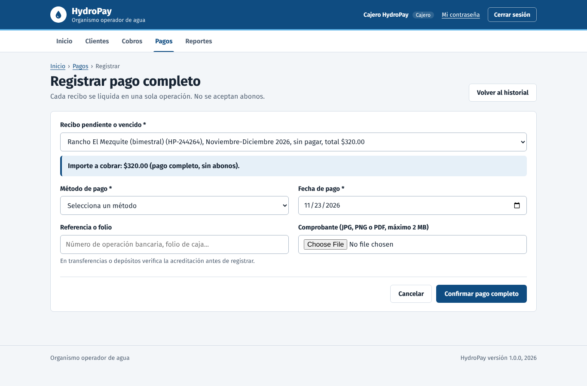
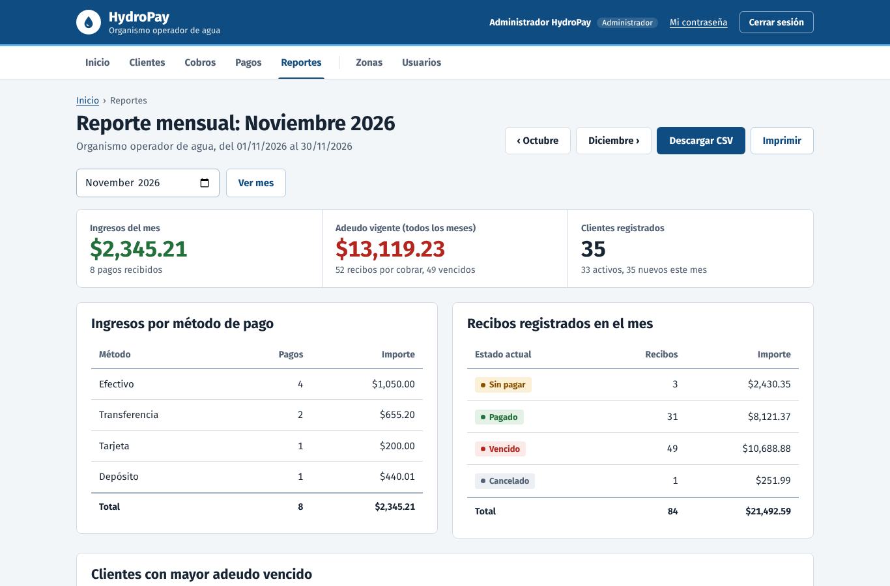
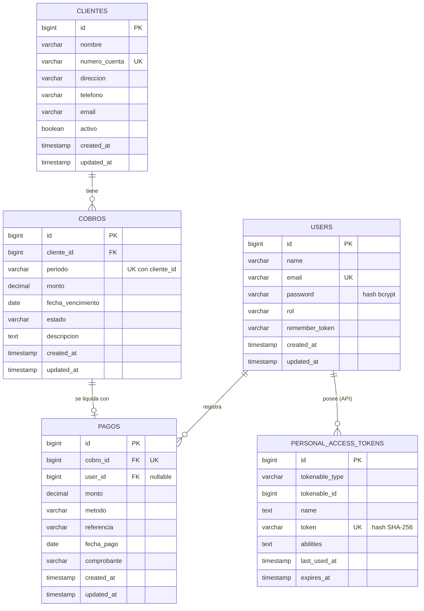
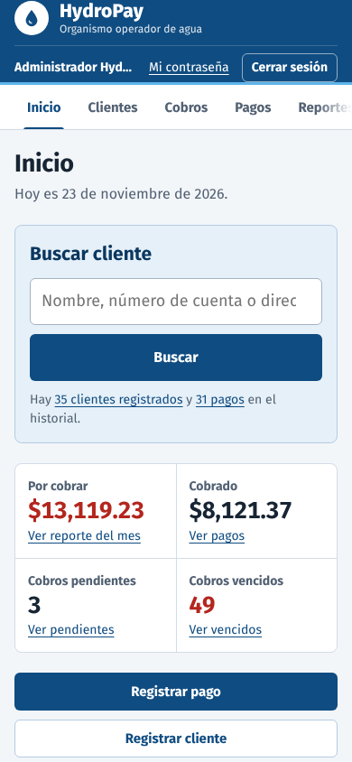
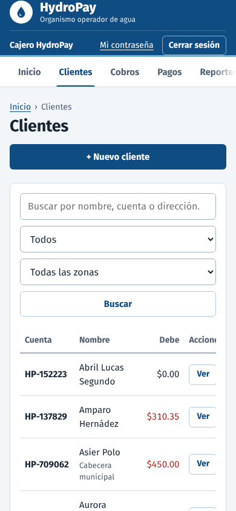

# 1. Datos generales del proyecto

| Dato | Valor |
|---|---|
| Proyecto | HydroPay |
| Versión | 1.0.0 (versión final, Actividad 7) |
| Fecha | 23 de noviembre de 2026 |
| Estudiante | Hugo Ascari Gutiérrez Padilla |
| Código | 215331313 |
| Asignatura | Tópicos Selectos de Tecnologías II |
| Profesor | Luis Alberto Luquin Pérez |
| Institución | Centro Universitario de los Valles (CUValles), Universidad de Guadalajara |
| Repositorio | <https://github.com/GitHugog/Hydropay> (Release `v1.0.0`) |
| Tecnologías | Laravel 13.34, PHP 8.4, Eloquent, Blade, SQLite, Laravel Sanctum 4, Pest 5 |

# 2. Introducción

HydroPay es una aplicación web que permite a un organismo operador de agua o a un comité comunitario administrar el padrón de clientes, registrar los recibos (adeudos) de cada periodo y controlar el cobro de cada recibo en un solo pago completo. Incluye control de acceso por roles, reportes mensuales y una API REST para que otras aplicaciones consulten y registren información con las mismas reglas.

Esta versión final integra el trabajo de las actividades anteriores (MVC, base de datos, autenticación, autorización y servicios de Laravel), corrige los errores detectados en la revisión, agrega el paquete Laravel Sanctum, la API, el módulo de reportes y la documentación completa.

# 3. Planteamiento del problema

En localidades alejadas de las cabeceras municipales el cobro del agua suele llevarse en libretas u hojas de cálculo: no hay un portal oficial, el personal cambia, se cobran recibos dos veces o se aceptan abonos que después no cuadran, y no existe un reporte confiable de lo cobrado y lo pendiente. Se requiere una herramienta sencilla, de bajo costo y segura que ordene el padrón, los recibos y los pagos, y que permita consultar la información desde otras aplicaciones.

# 4. Justificación

- **Control:** un recibo solo admite un pago completo; el sistema impide abonos y pagos dobles incluso con varios cajeros al mismo tiempo.
- **Transparencia:** cada pago registra quién lo cobró; los accesos denegados y las operaciones críticas quedan en el log.
- **Bajo costo:** funciona con SQLite en una computadora local y puede migrar a MySQL/PostgreSQL sin cambiar el código.
- **Integración:** la API permite una futura app de cobro en campo o la conexión con un sistema contable.

# 5. Objetivos

## 5.1 Objetivo general

Desarrollar una aplicación web en Laravel que administre clientes, recibos y pagos de un servicio de agua con autenticación, roles, reportes y una API REST segura.

## 5.2 Objetivos específicos

1. Diseñar una base de datos relacional con reglas de integridad (cuenta única, un periodo por cliente, un pago por recibo).
2. Implementar el patrón MVC con controladores, Form Requests, Policies, servicios y vistas Blade reutilizables.
3. Proteger el sistema con autenticación, middleware por rol, Policies, CSRF, hashing y validación.
4. Integrar servicios de Laravel (Cache, Collections, Events, Notifications, Mail, File Storage, Artisan, Helpers y Logging) con una aplicación real.
5. Exponer una API REST versionada con Laravel Sanctum y probarla con Pest y Postman.
6. Entregar una interfaz responsiva, documentación técnica y de usuario, y un historial Git organizado con una versión etiquetada.

# 6. Alcance y limitaciones

## 6.1 Alcance funcional

HydroPay cubre el ciclo **cliente → recibo → pago → reporte** para un organismo operador, con tres perfiles de personal (administrador, cajero y consulta) y acceso por interfaz web y por API.

## 6.2 Funcionalidades incluidas

| Módulo | Funcionalidades |
|---|---|
| Acceso | Inicio y cierre de sesión, bloqueo por intentos, recuperación por correo, cambio de contraseña |
| Panel | Indicadores (clientes, pendientes, vencidos, cobrado, por cobrar), últimos pagos, vencidos |
| Clientes | CRUD, búsqueda, filtro activo/inactivo, paginación, detalle con adeudo |
| Cobros | CRUD de recibos, filtro por estado, cálculo automático de vencidos, cancelación por administrador |
| Pagos | Pago completo por recibo, comprobante privado, historial, impresión, notificación al cliente |
| Reportes | Reporte mensual (ingresos por método, recibos por estado, adeudo, deudores), CSV e impresión |
| Usuarios | Alta, edición y baja de personal con rol (solo administrador) |
| API REST v1 | Autenticación por token, clientes, estado de cuenta, recibos, pagos y resumen |
| Tareas | Marcado diario de vencidos y limpieza de tokens vencidos |

## 6.3 Limitaciones

- El importe del recibo lo informa el organismo; HydroPay **no calcula tarifas** oficiales.
- No hay pagos en línea ni parcialidades; tampoco reversión de pagos (queda como mejora con autorización y bitácora).
- El correo de desarrollo se escribe en el log (`MAIL_MAILER=log`); en producción se necesita SMTP.
- SQLite es adecuado para un equipo; para varias cajas simultáneas se recomienda MySQL/MariaDB o PostgreSQL.
- No se implementó auto-registro público: el personal lo da de alta el administrador.

# 7. Análisis de requerimientos

## 7.1 Requerimientos funcionales

| ID | Requerimiento | Implementación |
|---|---|---|
| RF-01 | Iniciar y cerrar sesión | `AuthController`, rutas `login`/`logout` |
| RF-02 | Recuperar y cambiar la contraseña | `RecuperarPasswordController`, `CuentaController` |
| RF-03 | Administrar usuarios y roles | `UsuarioController` + `rol:admin` |
| RF-04 | CRUD de clientes con búsqueda y filtro | `ClienteController`, `ClienteRequest` |
| RF-05 | CRUD de recibos con estados | `CobroController`, `CobroRequest`, `CobroPolicy` |
| RF-06 | Registrar un único pago completo por recibo | `PagoController`, `RegistroPagoService` |
| RF-07 | Adjuntar y descargar comprobantes en forma privada | File Storage, ruta `pagos.comprobante` |
| RF-08 | Notificar al cliente su pago | `PagoRegistrado` → `NotificarPagoAlCliente` → `PagoRecibido` |
| RF-09 | Marcar recibos vencidos automáticamente | `hydropay:marcar-vencidos` + programador |
| RF-10 | Panel de indicadores | `DashboardController`, `ResumenService` |
| RF-11 | Reporte mensual y exportación CSV | `ReporteController`, `ReporteMensualService` |
| RF-12 | API REST con autenticación por token | `routes/api.php`, controladores `Api\*`, Sanctum |
| RF-13 | Cuota por cliente (mensual, bimestral o anual) y recibos automáticos del periodo | `GeneradorRecibosService`, `hydropay:generar-recibos`, ruta `cobros.generar` |
| RF-14 | Catálogo de zonas (municipio y localidad) y filtro de clientes por zona | `ZonaController`, `ZonaRequest`, `Zona`, API `GET /zonas` |

## 7.2 Requerimientos no funcionales

| ID | Requerimiento | Cómo se cumple |
|---|---|---|
| RNF-01 | Seguridad | Hash bcrypt, CSRF, middleware por rol, Policies, tokens con vencimiento, límites de intentos |
| RNF-02 | Integridad | Llaves foráneas, índices únicos, transacción con bloqueo en pagos |
| RNF-03 | Usabilidad | Mensajes en español, ruta de navegación, datos conservados al fallar la validación |
| RNF-04 | Diseño responsivo | Menú desplegable y una columna en celular (≤ 900 px y ≤ 600 px) |
| RNF-05 | Accesibilidad | Contraste AA, foco visible, "Saltar al contenido", `aria-*` en errores y menú |
| RNF-06 | Mantenibilidad | MVC, Form Requests y servicios compartidos, código comentado línea por línea |
| RNF-07 | Trazabilidad | Logging diario de accesos, pagos, eliminaciones, exportaciones y 403 |
| RNF-08 | Portabilidad | Migraciones independientes del motor; configuración por `.env` |
| RNF-09 | Calidad | 112 pruebas automatizadas Pest (Feature y Unit) |

## 7.3 Historias de usuario

| ID | Como… | Quiero… | Para… |
|---|---|---|---|
| HU-01 | cajero | registrar el pago completo de un recibo | liquidarlo sin errores de importe |
| HU-02 | cajero | buscar un cliente por cuenta o nombre | atenderlo rápido en ventanilla |
| HU-03 | administrador | dar de alta al personal con un rol | controlar quién puede cobrar |
| HU-04 | administrador | cancelar un recibo emitido por error | corregir sin borrar el historial |
| HU-05 | usuario de consulta | ver el reporte mensual | informar ingresos y adeudos |
| HU-06 | cliente del servicio | recibir un correo al pagar | tener constancia de su pago |
| HU-07 | desarrollador externo | consultar el estado de cuenta por API | integrar una app de cobro en campo |

## 7.4 Criterios de aceptación

| HU | Criterio | Verificación |
|---|---|---|
| HU-01 | El importe registrado es exactamente el del recibo; un abono o un segundo pago muestran error | CP-06 a CP-09, AP-23 a AP-25 |
| HU-02 | La búsqueda devuelve coincidencias por nombre, cuenta o dirección con 10 por página | CL-06 |
| HU-03 | Solo el administrador entra a Usuarios; la contraseña se guarda con hash | AZ-01 a AZ-03, AZ-12 |
| HU-04 | Solo el administrador cancela; un recibo cancelado no admite pagos | AZ-09, CP-11 |
| HU-05 | El reporte del mes suma solo pagos de ese mes (incluido el último día) | RE-03 |
| HU-06 | Al registrar un pago de un cliente con correo se envía `PagoRecibido` | CP-13 |
| HU-07 | `GET /clientes/{id}/estado-cuenta` devuelve recibos por pagar y total adeudado | AP-20 |

# 8. Metodología y herramientas

## 8.1 Metodología

Desarrollo incremental por actividades: (5) MVC, rutas, formularios y Blade; (6) autenticación, autorización y servicios; (7) revisión integral, API, paquete adicional, pruebas, limpieza, documentación y versión final. Cada incremento se integró a `main` mediante ramas y commits descriptivos.

## 8.2 Tecnologías y herramientas

| Herramienta | Versión | Uso |
|---|---|---|
| Laravel Framework | 13.34.0 | Framework MVC |
| PHP | 8.4.25 | Lenguaje (Laravel Herd) |
| Laravel Sanctum | 4.x | Paquete adicional: tokens de la API |
| Pest | 5.2 | Pruebas automatizadas |
| SQLite | 3 | Base de datos de desarrollo |
| Composer | 2.8 | Dependencias |
| Laravel Herd | — | Entorno local en Windows |
| Visual Studio Code | — | Editor |
| Postman | — | Pruebas manuales de la API |
| Git / GitHub | — | Control de versiones, issues y release |
| Claude, Laravel Boost + Codex | — | Asistencia de IA (sección 20) |

# 9. Análisis y diseño del sistema

## 9.1 Arquitectura general

{width=78%}

Las dos entradas tienen su propio tipo de autenticación (sesión con CSRF en la web; token Bearer en la API) pero **comparten** Form Requests, Policies, servicios y modelos. Así una regla de negocio (por ejemplo, "sin abonos") se programa una sola vez.

## 9.2 Patrón MVC

| Capa | En HydroPay |
|---|---|
| **Modelo** | `app/Models`: `User`, `Cliente`, `Cobro`, `Pago` con relaciones, scopes (`buscar`, `filtrar`, `porPagar`) y reglas (`recalcularEstado`, `saldo`, `tienePago`) |
| **Vista** | `resources/views`: layout `app` dividido en parciales, 4 componentes Blade, vistas por módulo y páginas de error; en la API, `app/Http/Resources` |
| **Controlador** | `app/Http/Controllers` (web) y `app/Http/Controllers/Api`; delegan validación a Form Requests, permisos a Policies y lógica a servicios |

## 9.3 Roles y actores

| Actor | Acceso |
|---|---|
| Administrador | Total, incluidas eliminaciones, cancelación de recibos y usuarios |
| Cajero | Registra y edita clientes y recibos; registra pagos |
| Consulta | Solo lectura (web y API) |
| Cliente del servicio | No inicia sesión; recibe el correo de confirmación |
| Aplicación externa | API con token y habilidades según el rol del usuario |

## 9.4 Flujo funcional



Flujo principal: el cajero registra el cliente → registra el recibo del periodo → al cobrar, elige el recibo y confirma; el sistema bloquea el recibo, verifica que no esté pagado ni cancelado, toma el importe de la base, guarda el comprobante, registra el pago y dispara el evento que marca el recibo como pagado y notifica al cliente. Cada noche el comando programado marca los vencidos y el reporte mensual resume lo cobrado y lo pendiente.

## 9.5 Diseño de navegación



## 9.6 Wireframes o prototipos

Las siguientes imágenes son **prototipos de alta fidelidad renderizados directamente a partir de las plantillas Blade del proyecto** con datos ficticios; las capturas del sistema ejecutándose se integran en el Anexo H.







# 10. Diseño de la base de datos

## 10.1 Identificación de entidades

| Entidad | Tabla | Propósito |
|---|---|---|
| Usuario del sistema | `users` | Personal que inicia sesión (admin, cajero, consulta) |
| Cliente | `clientes` | Titular de una cuenta del servicio |
| Recibo | `cobros` | Importe de un periodo que debe pagar una cuenta |
| Pago | `pagos` | Liquidación completa de un recibo |
| Token de API | `personal_access_tokens` | Tokens de Sanctum con habilidades y vencimiento |
| Soporte | `sessions`, `password_reset_tokens`, `cache`, `jobs` | Tablas técnicas de Laravel |

`clientes.activo` indica si el registro está habilitado; los estados `pendiente`, `vencido`, `pagado` y `cancelado` pertenecen a cada recibo.

## 10.2 Diagrama entidad-relación

{width=72%}

## 10.3 Modelo relacional

```text
users (id PK, name, email UK, email_verified_at, password, rol, remember_token, created_at, updated_at)
clientes (id PK, nombre, numero_cuenta UK, direccion, telefono, email, activo, created_at, updated_at)
cobros (id PK, cliente_id FK→clientes, periodo, monto, fecha_vencimiento, estado, descripcion,
        UK(cliente_id, periodo), created_at, updated_at)
pagos (id PK, cobro_id FK→cobros UK, user_id FK→users NULL, monto, metodo, referencia,
       fecha_pago, comprobante, created_at, updated_at)
personal_access_tokens (id PK, tokenable_type, tokenable_id, name, token UK, abilities,
                        last_used_at, expires_at, created_at, updated_at)
```

## 10.4 Diccionario de datos

El diccionario completo (tipo, nulidad, llaves y validación de cada campo) está en el **Anexo C** (`docs/DICCIONARIO_DATOS.md`).

## 10.5 Llaves primarias y foráneas

| Tabla | Llave | Regla |
|---|---|---|
| `clientes` | `numero_cuenta` UNIQUE | Evita cuentas duplicadas |
| `cobros` | `cliente_id` FK RESTRICT | No se borra un cliente con recibos |
| `cobros` | UNIQUE(`cliente_id`, `periodo`) | Un recibo por periodo y cliente |
| `pagos` | `cobro_id` FK RESTRICT + UNIQUE | Un pago por recibo; no se borra un recibo pagado |
| `pagos` | `user_id` FK SET NULL | Si se elimina el usuario, el pago se conserva |
| `personal_access_tokens` | `token` UNIQUE | Hash único por token |

## 10.6 Reglas de integridad

1. Número de cuenta único.
2. Un cliente no tiene dos recibos del mismo periodo.
3. Un recibo admite cero o un pago (índice único y bloqueo `lockForUpdate` en la transacción).
4. El pago cubre exactamente el importe del recibo; el servidor toma el monto de la base.
5. Un recibo pagado no se edita ni se elimina; un recibo cancelado no se cobra.
6. Un cliente con recibos no se elimina.
7. Al crear un pago por cualquier vía (interfaz, API, seeder) el recibo se recalcula como pagado (evento `created` del modelo).
8. Los pagos no se editan ni eliminan (no existen rutas; `PagoPolicy` lo niega).

## 10.7 Migraciones, seeders y factories

Diez migraciones (detalle en el Anexo A, sección 5). La migración `2026_11_09_000001_ajustar_integridad_hydropay` agrega índices únicos de forma condicional y la `2026_11_21_000001_create_personal_access_tokens_table` crea la tabla de Sanctum sin depender de `install:api`; `2026_11_22_000001_agregar_cuota_a_clientes_table` agrega `periodicidad` y `tarifa` al cliente, y `2026_11_22_000002_create_zonas_table` crea el catálogo de zonas y `clientes.zona_id`. `DatabaseSeeder` crea los tres usuarios de demostración, 4 zonas del municipio de Tala, 27 clientes con cuota y zona (25 mensuales, uno bimestral y uno anual) y 77 recibos (septiembre a noviembre de 2026 más los del periodo actual que crea `GeneradorRecibosService`) con algunos pagos completos. Las factories `UserFactory` (estados `admin()`, `cajero()`), `ClienteFactory` (`inactivo()`, `conCuota()`), `ZonaFactory`, `CobroFactory` (`vencido()`, periodos únicos consecutivos) y `PagoFactory` (importe igual al del recibo) alimentan las pruebas.

# 11. Arquitectura e implementación

## 11.1 Estructura del proyecto

```text
app/
  Console/Commands/MarcarCobrosVencidos.php   Comando Artisan
  Events/PagoRegistrado.php                    Evento
  Http/Controllers/                            Controladores web
  Http/Controllers/Api/                        Controladores de la API
  Http/Middleware/VerificarRol.php             Middleware propio por rol
  Http/Requests/                               Form Requests (+ Concerns/LimpiaEntradas)
  Http/Resources/                              Transformadores JSON de la API
  Listeners/                                   ActualizarEstadoCobro, NotificarPagoAlCliente
  Models/                                      User, Cliente, Cobro, Pago
  Notifications/PagoRecibido.php               Correo al cliente
  Policies/                                    PoliticaBase, ClientePolicy, CobroPolicy, PagoPolicy
  Services/                                    RegistroPago, Resumen, ReporteMensual
  Support/helpers.php                          formato_moneda, nombre_mes, etiqueta_estado
bootstrap/app.php                              Rutas, alias de middleware y manejo de errores
config/hydropay.php                            Configuración propia
lang/es/, lang/es.json                         Traducciones
resources/views/                               Layouts, parciales, componentes, módulos y errores
routes/web.php, api.php, console.php           Rutas web, API y tareas programadas
public/css/hydropay.css, public/js/hydropay.js Estilos y comportamiento de la interfaz
tests/Feature, tests/Unit                      112 pruebas Pest
docs/                                          Documentación, diagramas y colección Postman
```

## 11.2 Rutas

Todas las rutas tienen nombre. Resumen (`php artisan route:list`):

| Método | URI | Nombre | Middleware |
|---|---|---|---|
| GET/POST | `/login` | `login` / `login.intento` | guest |
| GET/POST | `/olvide-mi-contrasena` | `password.request` / `password.email` | guest, throttle:5,1 |
| GET | `/restablecer-contrasena/{token}` | `password.reset` | guest (parámetro obligatorio) |
| POST | `/restablecer-contrasena` | `password.update` | guest, throttle:5,1 |
| POST | `/logout` | `logout` | auth |
| GET | `/dashboard` | `dashboard` | auth |
| GET/PUT | `/cuenta/contrasena` | `cuenta.password.edit` / `.update` | auth |
| GET | `/clientes`, `/clientes/{cliente}` | `clientes.index` / `.show` | auth |
| GET/POST/PUT | `/clientes/create`, `/clientes`, `/clientes/{cliente}/edit`, `/clientes/{cliente}` | `clientes.create/store/edit/update` | auth, **rol:admin,cajero** |
| DELETE | `/clientes/{cliente}` | `clientes.destroy` | auth, **rol:admin** |
| (igual) | `/cobros…` | `cobros.*` | igual que clientes |
| GET | `/pagos`, `/pagos/{pago}`, `/pagos/{pago}/comprobante` | `pagos.index/show/comprobante` | auth |
| GET/POST | `/pagos/create`, `/pagos` | `pagos.create/store` | auth, rol:admin,cajero |
| GET | `/reportes/{anio?}/{mes?}` | `reportes.index` | auth (parámetros **opcionales**, `whereNumber`) |
| GET | `/reportes/{anio}/{mes}/csv` | `reportes.csv` | auth (parámetros obligatorios) |
| (resource) | `/usuarios…` | `usuarios.*` (sin show) | auth, rol:admin |
| — | `/api/v1/*` | `api.v1.*` | ver sección 15 |

## 11.3 Controladores

| Controlador | Responsabilidad |
|---|---|
| `AuthController` | Login con límite de intentos, logout con invalidación de sesión |
| `RecuperarPasswordController` | Enlace por correo y restablecimiento con token |
| `CuentaController` | Cambio de contraseña con la actual |
| `DashboardController` | Indicadores, últimos pagos, vencidos |
| `ClienteController` | CRUD, búsqueda, filtro, detalle con adeudo |
| `CobroController` | CRUD de recibos y estados |
| `PagoController` | Historial, registro mediante `RegistroPagoService`, comprobante |
| `ReporteController` | Reporte mensual con redirección desde el selector y exportación CSV |
| `UsuarioController` | Usuarios y roles; protege al último administrador y revoca tokens |
| `Api\AuthController` | Token, logout y perfil |
| `Api\ClienteController` | CRUD JSON y estado de cuenta |
| `Api\CobroController`, `Api\PagoController`, `Api\ResumenController` | Recibos, pagos y resumen en JSON |

## 11.4 Modelos

| Modelo | Relaciones | Reglas |
|---|---|---|
| `User` | `pagos()`, `tokens()` (Sanctum) | `esAdmin()`, `puedeOperar()`, `habilidadesApi()`, cast `hashed` |
| `Cliente` | `cobros()`, `pagos()` (hasManyThrough) | `adeudo()`, scope `buscar()` |
| `Cobro` | `cliente()`, `pago()` (hasOne) | `recalcularEstado()`, `saldo()`, `tienePago()`, scopes `porPagar()`, `filtrar()` |
| `Pago` | `cobro()`, `registradoPor()` | Evento `created` recalcula el recibo; scope `filtrar()` |

Los modelos invalidan la caché del panel en sus eventos `saved` y `deleted`.

## 11.5 Vistas y plantillas Blade

- `layouts/app.blade.php` define la estructura con `@yield('titulo')` y `@yield('contenido')` e incluye con `@include` los parciales **menú**, **encabezado** (botón de menú móvil, ruta de navegación y título), **mensajes** y **pie**.
- `layouts/guest.blade.php` (login y recuperación) reutiliza el parcial de mensajes; `layouts/error.blade.php` sirve a las páginas 403, 404, 405, 419, 429, 500 y 503 sin depender de la sesión.
- Componentes Blade anónimos: `<x-alerta>`, `<x-estado-cobro>`, `<x-indicador>` y `<x-boton-eliminar>` (este último incluye `@csrf`, `@method('DELETE')` y confirmación).
- Formularios parciales reutilizados en alta y edición: `clientes/_form`, `cobros/_form`, `usuarios/_form`.

## 11.6 Formularios

Login, recuperación, nueva contraseña, cambio de contraseña, cliente, recibo, pago (con `enctype="multipart/form-data"`), usuario, buscadores GET y selector de mes. Todos los formularios que modifican datos llevan `@csrf`; los de edición y eliminación usan `@method('PUT')` o `@method('DELETE')`. Los campos conservan lo capturado con `old()` y marcan el error con `aria-invalid`.

## 11.7 Validaciones

| Form Request | Autoriza con | Reglas principales |
|---|---|---|
| `ClienteRequest` | `ClientePolicy` create/update | nombre, cuenta única (ignora el propio registro), dirección, teléfono con `regex`, correo, `activo` booleano |
| `CobroRequest` | `CobroPolicy` create/update/**cancelar** | cliente existente (activo al crear), periodo único por cliente, monto `decimal:0,2` entre 0.01 y 99,999,999.99, estado `pendiente/cancelado` al editar |
| `PagoRequest` | `PagoPolicy` create | recibo existente, método en lista, fecha `before_or_equal:today`, comprobante `mimes:jpg,jpeg,png,pdf` `max:2048`, monto opcional |
| `UsuarioRequest` | Gate `gestionar-usuarios` | correo único en minúsculas, rol en lista, `Password::min(8)->letters()->numbers()` |

El rasgo `LimpiaEntradas` quita etiquetas HTML y espacios **antes** de validar (`prepareForValidation`), de modo que se valida exactamente lo que se guarda. La API usa los mismos Form Requests y responde 422 en JSON.

## 11.8 Sesiones y mensajes

Los controladores redirigen con mensajes *flash*: `mensaje` (éxito), `error` (regla de negocio) y `status` (informativo). El parcial `mensajes` los muestra con `<x-alerta>` y lista todos los errores de validación. Las sesiones se guardan en la base (`SESSION_DRIVER=database`), se regeneran al iniciar sesión y se invalidan al cerrarla.

## 11.9 Middleware

| Middleware | Tipo | Aplicación |
|---|---|---|
| `VerificarRol` (alias `rol`) | **Propio**, con parámetros | `rol:admin,cajero` en altas y ediciones; `rol:admin` en eliminaciones y usuarios. Devuelve 403 con mensaje aunque se escriba la URL |
| `auth` / `guest` | Laravel | Rutas protegidas / solo visitantes |
| `auth:sanctum` | Sanctum | Rutas de la API |
| `abilities` | Sanctum (alias registrado) | `abilities:leer`, `escribir`, `eliminar` |
| `throttle` | Laravel | Login API 5/min, API 60/min, recuperación 5/min |

## 11.10 Localización

`APP_LOCALE=es`. Archivos: `lang/es/validation.php` (todas las reglas del framework, atributos y mensajes personalizados), `auth.php`, `passwords.php`, `pagination.php`, `hydropay.php` (mensajes del sistema, estados, métodos, roles y errores de la API) y `lang/es.json` (correo de recuperación y resumen de errores 422). Los controladores usan `__('hydropay.clientes.creado')` en lugar de textos fijos.

# 12. Funcionalidad del sistema

## 12.1 Módulos principales

Panel, Clientes, Cobros, Pagos, Reportes, Usuarios, Mi cuenta y API REST. El uso paso a paso está en el **Anexo B** (Manual de usuario).

## 12.2 Operaciones CRUD

| Módulo | Crear | Consultar | Modificar | Eliminar |
|---|---|---|---|---|
| Clientes | Admin, cajero | Todos | Admin, cajero | Admin, sin recibos |
| Cobros | Admin, cajero | Todos | Admin, cajero (no pagados; cancelados solo admin) | Admin, sin pago |
| Pagos | Admin, cajero | Todos | No (inmutable) | No (inmutable) |
| Usuarios | Admin | Admin | Admin | Admin (no a sí mismo ni al último admin) |

## 12.3 Relaciones de base de datos

Cliente 1:N Cobros; Cobro 1:0..1 Pago; Cliente 1:N Pagos a través de Cobros; Usuario 1:N Pagos registrados; Usuario 1:N Tokens de API.

## 12.4 Consultas y filtros

Clientes por nombre/cuenta/dirección y estado; recibos por cliente/cuenta/periodo y estado; pagos por referencia/cliente/cuenta y método; usuarios por nombre o correo. La API agrega `cliente_id` y `por_pagina`.

## 12.5 Paginación y búsqueda

`paginate(10)->withQueryString()` en la web con vista de paginación propia; la API pagina 15 por defecto (máximo 50) e incluye `links` y `meta`.

## 12.6 Reportes

`ReporteMensualService` usa Collections para agrupar los pagos del mes por método y los recibos por estado, calcula el adeudo vigente y los diez clientes con mayor adeudo vencido. El selector de mes envía `?periodo=AAAA-MM` y el controlador **redirige** a la URL limpia `/reportes/AAAA/MM`. El CSV se genera con `streamDownload` y BOM UTF-8 para Excel.

# 13. Seguridad

## 13.1 Registro y autenticación

Login con `Auth::attempt`, límite de 5 intentos por minuto por correo e IP, regeneración del ID de sesión, logout por POST con invalidación de sesión y token CSRF. El registro de usuarios corresponde al administrador (no hay auto-registro público, por tratarse de personal del organismo). En la API, el login entrega un token Sanctum con vencimiento de 8 horas.

## 13.2 Roles y permisos

| Acción | Admin | Cajero | Consulta |
|---|---|---|---|
| Consultar clientes, recibos, pagos y reportes | Sí | Sí | Sí |
| Registrar/editar clientes y recibos | Sí | Sí | No |
| Registrar pagos | Sí | Sí | No |
| Cancelar o editar recibos cancelados | Sí | No | No |
| Eliminar clientes o recibos sin movimientos | Sí | No | No |
| Administrar usuarios | Sí | No | No |
| Editar o eliminar pagos | No | No | No |

## 13.3 Middleware de autorización

`VerificarRol` revisa el rol antes de llegar al controlador. Ejemplo: un cajero que escribe `/usuarios` recibe la página 403 con el motivo y el intento queda en el log como `Acceso denegado (403)` con usuario, rol, método y URL.

## 13.4 Policies y Gates

`PoliticaBase` devuelve respuestas con mensaje (`Response::deny`). `CobroPolicy::update` niega editar recibos pagados y, salvo al administrador, recibos cancelados; `CobroPolicy::cancelar` reserva la cancelación al administrador; `PagoPolicy` niega editar y eliminar pagos. El Gate `gestionar-usuarios` controla el menú y `UsuarioRequest`. Las mismas Policies se aplican en la API.

## 13.5 Recuperación de contraseña

Enlace con token de 60 minutos (`password_reset_tokens`), mensaje genérico que no revela si el correo existe, límite de 5 solicitudes por minuto, nueva contraseña con política, renovación de `remember_token` y revocación de los tokens de la API. Correo traducido al español (`lang/es.json`).

## 13.6 Protección CSRF

Middleware `VerifyCsrfToken` del grupo web; `@csrf` en todos los formularios, incluido el componente `<x-boton-eliminar>`; la página 419 explica la expiración. La API no usa cookies, por lo que se protege con el token Bearer.

## 13.7 Hashing y cifrado

Contraseñas con bcrypt mediante el cast `hashed` (`BCRYPT_ROUNDS=12`). Sanctum guarda solo el hash SHA-256 del token; el texto plano se muestra una sola vez. Las sesiones y cookies se firman con `APP_KEY`.

## 13.8 Validación y protección de datos

Validación en servidor con Form Requests, limpieza de HTML antes de validar, escape automático de Blade `{{ }}`, consultas parametrizadas de Eloquent, comprobantes en disco privado con descarga autenticada, importe del pago tomado del servidor y Resources que nunca exponen contraseñas ni rutas internas.

## 13.9 Consideraciones de seguridad

Para producción: HTTPS, `APP_DEBUG=false`, `SESSION_ENCRYPT=true` y `SESSION_SECURE_COOKIE=true`, SMTP institucional, base MySQL/PostgreSQL con respaldos, permisos de carpetas, cambio o eliminación de las cuentas de demostración, revisión periódica del log y una política de reversión de pagos con autorización. `.env` no se versiona y `.env.example` no contiene secretos.

# 14. Servicios de Laravel utilizados

| Servicio | Dónde | Aplicación real |
|---|---|---|
| **Artisan Console** | `MarcarCobrosVencidos`, `routes/console.php` | Marca vencidos a las 00:05; limpia tokens vencidos con `sanctum:prune-expired` |
| **Collections** | `ResumenService`, `ReporteMensualService`, `bootstrap/app.php` | `groupBy`, `map`, `sum`, `sortByDesc`, `mapWithKeys` para indicadores y reportes |
| **Cache** | `ResumenService` | Resumen del panel por 5 minutos; se invalida al cambiar clientes, recibos o pagos |
| **Events y Listeners** | `PagoRegistrado` → `ActualizarEstadoCobro`, `NotificarPagoAlCliente` | Separa lo que ocurre después de un pago |
| **File Storage** | `RegistroPagoService`, `PagoController::comprobante` | Comprobantes en `storage/app/private/comprobantes`; se borran si el pago falla |
| **Mail / Notifications** | `PagoRecibido`, `ResetPassword` | Confirmación de pago y recuperación de contraseña |
| **Helpers** | `app/Support/helpers.php` | `formato_moneda()`, `nombre_mes()`, `etiqueta_estado()` en vistas, reportes, correo y API |
| **Logging** | Controladores, servicios, `bootstrap/app.php` | Accesos, intentos fallidos, pagos, eliminaciones, exportaciones, 403 y errores (canal diario) |

# 15. API REST

## 15.1 Diseño

API versionada (`/api/v1`), recursos en plural, respuestas JSON con `data` (y `links`/`meta` en listados), códigos HTTP estándar y mensajes en español. Los controladores `Api\*` reutilizan Form Requests, Policies y servicios de la web.

## 15.2 Autenticación

`POST /api/v1/auth/login` entrega un token Bearer de Sanctum con habilidades según el rol (admin: `leer`, `escribir`, `eliminar`; cajero: `leer`, `escribir`; consulta: `leer`) y vencimiento de 8 horas. El middleware `abilities` revisa la habilidad de cada ruta y la Policy revisa el rol real.

## 15.3 Endpoints

| Método | Endpoint | Habilidad |
|---|---|---|
| POST | `/auth/login` · `/auth/logout` · GET `/auth/yo` | — / token |
| GET | `/resumen` | leer |
| GET · POST | `/clientes` | leer · escribir |
| GET · PUT/PATCH · DELETE | `/clientes/{id}` | leer · escribir · eliminar |
| GET | `/clientes/{id}/estado-cuenta` | leer |
| GET · POST | `/cobros` | leer · escribir |
| GET · PUT/PATCH · DELETE | `/cobros/{id}` | leer · escribir · eliminar |
| GET · POST | `/pagos` | leer · escribir |
| GET | `/pagos/{id}` | leer |

Parámetros, cuerpos y ejemplos de respuesta: **Anexo E** (`docs/API.md`).

## 15.4 Manejo de errores de la API

`bootstrap/app.php` convierte las excepciones de `/api/*` en JSON en español: 401 sin token, 403 sin habilidad o permiso (con el motivo de la Policy), 404, 405, 409 (conflicto de integridad), 422 (validación con `errors` por campo), 429 (con `Retry-After`) y 500 sin detalles técnicos.

## 15.5 Pruebas con Postman

Colección `docs/postman/HydroPay_API.postman_collection.json` con 37 solicitudes en 6 carpetas (autenticación, clientes, cobros, pagos, autorización, resumen). Guarda tokens e identificadores en variables y verifica automáticamente el código HTTP esperado para datos válidos, inválidos, vacíos, usuario autorizado y no autorizado. Se ejecuta completa con el *Collection Runner*.

# 16. Paquete adicional: Laravel Sanctum

## 16.1 Selección

`laravel/sanctum` (versión 4, compatible con Laravel 13), instalado con `composer require laravel/sanctum`.

## 16.2 Justificación técnica

- La actividad pide una API propia; la API necesita autenticación **sin sesión ni cookies** para clientes como Postman o una app móvil. Sanctum emite tokens personales por usuario.
- Las **habilidades** del token permiten mapear los roles de HydroPay a permisos de la API sin tablas adicionales.
- Guarda solo el hash del token, permite **vencimiento** por token y revocación individual (logout) o masiva (cambio de rol o de contraseña).
- Es paquete oficial de Laravel: se integra con los guards, las Policies y el manejo de errores existentes; incluye `Sanctum::actingAs()` para pruebas.

## 16.3 Alternativas descartadas

| Alternativa | Motivo |
|---|---|
| Laravel Passport | Servidor OAuth2 completo: más complejidad de la necesaria para tokens de primera parte |
| Token propio en una columna de `users` | Reinventa hashing, vencimiento y habilidades; menos seguro |
| Spatie Laravel Permission | Útil con muchos permisos dinámicos; HydroPay tiene tres roles fijos |
| barryvdh/laravel-dompdf | El comprobante y el reporte ya se imprimen o guardan como PDF desde el navegador |

## 16.4 Integración

Rasgo `HasApiTokens` en `User`; migración `personal_access_tokens`; alias `abilities`/`ability` en `bootstrap/app.php`; rutas con `auth:sanctum`; `createToken(nombre, habilidades, vencimiento)` en `Api\AuthController`; revocación en logout, cambio de rol, restablecimiento de contraseña y baja de usuario; limpieza diaria `sanctum:prune-expired`; pruebas con `Sanctum::actingAs`.

# 17. Interfaz de usuario

## 17.1 Criterios de diseño

La interfaz se planteó como la **ventanilla del servicio municipal de agua** y no como una plantilla de panel administrativo. Decisiones y su razón:

| Elemento | Decisión | Razón |
|---|---|---|
| Color de identidad | Azul agua profundo `#0F4C81` en el membrete, botones principales y enlaces, con una línea azul claro `#5FB4E8` bajo el membrete (el nivel del agua) | El servicio es agua y el azul se reconoce de inmediato; un tono profundo, distinto del azul brillante de las plantillas, a propuesta del estudiante |
| Fondo y superficies | Blanco frío `#F3F6F9` y superficies blancas con borde, sin sombras | Lectura limpia; las cifras y tablas no compiten con decoración |
| Rojo `#B3261E` | Solo para lo que se debe (adeudos, vencidos) y errores | Que el rojo signifique siempre "atención: dinero pendiente" |
| Estados del recibo | Punto de color + texto: ámbar sin pagar, rojo vencido, verde pagado, gris cancelado | El color nunca es la única señal |
| Tipografía de texto | Atkinson Hyperlegible Next (Google Fonts) | Diseñada para personas con baja visión: personal de mayor edad y celulares al sol; distingue 0/O y 1/l en cuentas e importes |
| Títulos e importes | Archivo semicondensada, cifras de ancho fijo | Importes grandes que caben en celular y columnas de dinero alineadas |
| Foco del teclado | Contorno amarillo maíz `#F0B323` en enlaces y botones; halo azul en campos | Visible sobre fondos claros y sobre el membrete |
| Textos | Frases en minúscula inicial, sin etiquetas en mayúsculas ni flechas decorativas, botones con el verbo de la acción | Que cada texto ayude a usar el sistema |

Sin internet las tipografías se sustituyen por las del equipo y la interfaz sigue funcionando.

## 17.2 Estructura visual

Membrete azul con la marca, el nombre del organismo (`HYDROPAY_ORGANISMO`), el usuario con su rol, *Mi contraseña* y *Cerrar sesión* · pestañas de módulos (Inicio, Clientes, Cobros, Pagos, Reportes y, para el administrador, Zonas y Usuarios) · contenido (ruta de navegación, título con sus acciones, filtros, tablas o formularios) · pie con el organismo y la versión. El inicio abre con el **buscador de clientes**, porque es lo primero que hace el cajero cuando alguien llega a pagar, seguido de las cifras del servicio en una sola franja y de las acciones frecuentes.

## 17.3 Navegación

Pestañas siempre visibles con el módulo activo subrayado y `aria-current`; ruta de navegación automática (Inicio › Módulo › Acción) calculada a partir del nombre de la ruta; cifras del inicio que abren listados ya filtrados; botón **Cobrar** desde la ficha del cliente y desde la lista de recibos; botones Volver/Cancelar en todos los formularios; mes anterior/siguiente en reportes.

## 17.4 Diseño responsivo

| Ancho | Comportamiento |
|---|---|
| > 900 px | Pestañas completas; cifras en una franja; dos paneles lado a lado; formularios en 2 columnas |
| ≤ 900 px | Paneles apilados; el login pasa de dos columnas a franja superior |
| ≤ 640 px | La sesión baja a su propia línea; las pestañas se deslizan de lado (se desvanecen a la derecha para indicar que hay más); cifras en 2 columnas; formularios en una columna con el botón principal arriba; buscador y filtros a todo lo ancho; tablas con desplazamiento horizontal |
| Impresión | Oculta membrete, pestañas, botones y filtros (comprobante y reporte) |

{width=35%} {width=35%}

## 17.5 Usabilidad

Mensajes de éxito/error persistentes en la siguiente pantalla, resumen de errores y error por campo, datos conservados, confirmación antes de eliminar, aviso dinámico del importe exacto al cobrar, estados vacíos con la siguiente acción sugerida y páginas de error con botón para volver.

# 18. Pruebas

## 18.1 Estrategia

Pruebas automatizadas con Pest sobre SQLite en memoria (no tocan la base real) más pruebas manuales en navegador y Postman. Cada módulo se prueba con datos válidos, inválidos, campos vacíos, usuario autorizado y no autorizado. Matriz completa: **Anexo D**.

## 18.2 Pruebas automatizadas

| Archivo | Pruebas | Cubre |
|---|---|---|
| `Feature/AutenticacionTest.php` | 14 | Login, bloqueo, logout, recuperación, cambio de contraseña |
| `Feature/AutorizacionTest.php` | 12 | Roles, middleware, Policies, hash, protecciones de usuarios |
| `Feature/ClienteCrudTest.php` | 9 | CRUD, validación, `old()`, búsqueda, filtros, sanitización, relaciones |
| `Feature/CobroPagoTest.php` | 19 | Recibos, pagos, reglas de negocio, eventos, archivos, comando |
| `Feature/ReporteTest.php` | 8 | Parámetros opcionales, totales, 404, redirección, CSV |
| `Feature/ErroresTest.php` | 5 | Páginas 404/403 y logging de 403 reales |
| `Feature/Api/*` | 31 | Tokens, habilidades, CRUD JSON, 401/403/404/405/409/422 |
| `Unit/HelpersTest.php` | 2 | Helpers |
| **Total** | **100** | |

## 18.3 Pruebas de validación

Campos obligatorios, formatos (correo, teléfono, fecha, decimales), unicidad (cuenta, periodo por cliente, correo de usuario), listas cerradas (método, rol, estado), archivos (tipo y tamaño), reglas de negocio (abono, segundo pago, recibo cancelado, cliente inactivo), sanitización y mensajes en español sin claves sin traducir.

## 18.4 Pruebas de autenticación y autorización

Acceso sin sesión, credenciales válidas e inválidas, campos vacíos, bloqueo por intentos, recuperación con token válido e inválido, cambio de contraseña, acceso por URL a módulos restringidos (403), permisos por rol en cada operación, Policies de recibos pagados y cancelados, y protecciones del módulo de usuarios.

## 18.5 Pruebas de la API

Emisión, uso, revocación y vencimiento de tokens; habilidades por rol; defensa en profundidad (habilidad presente pero rol sin permiso); CRUD y estado de cuenta; códigos 401, 403, 404, 405, 409 y 422 con mensajes en español. Se repiten manualmente con la colección Postman.

## 18.6 Manejo de errores

Operaciones críticas con `try/catch` y transacción (registro de pago, eliminación de recibo, envío de correos); páginas de error propias; JSON de error en la API; registro en el log de cada error y de cada acceso denegado.

## 18.7 Errores identificados y correcciones realizadas

| # | Error | Evidencia | Causa | Corrección |
|---|---|---|---|---|
| 1 | Log saturado de avisos falsos "Autorización denegada" | 31 avisos en `laravel.log` el 17/11/2026 navegando como cajero | `Gate::after` registraba también cada `@can` de las vistas | Se eliminó; ahora solo se registran los 403 reales en `bootstrap/app.php` (prueba ER-04/ER-05) |
| 2 | `Please provide a valid cache path.` | `laravel.log`, 17/11/2026 | El paquete no incluía `storage/framework/views` y demás carpetas | Se agregaron sus `.gitignore` para que existan en cualquier clon |
| 3 | `Database file at path [database/database.sqliteAPP_NAME=HydroPay]` | `laravel.log`, 17/11/2026 | Línea de `.env` sin salto de línea | Se documentó el formato correcto; `.env.example` ya no fija `DB_DATABASE` |
| 4 | Mensajes `validation.decimal`, `validation.integer` sin traducir | Revisión de código | `lang/es/validation.php` incompleto y respaldo en español | Archivo completo, mensajes personalizados y `APP_FALLBACK_LOCALE=en` (prueba CP-05) |
| 5 | Correo de recuperación en inglés | Revisión | Faltaba `lang/es.json` | Traducciones JSON agregadas |
| 6 | El comando de vencidos podía omitir recibos | Revisión | `each()` sobre `chunk` con el filtro que se modifica | `lazyById(200)` |
| 7 | El requisito original de Reportes no existía | Comparación con el planteamiento | Pendiente de actividades previas | Módulo de reportes con CSV |
| 8 | Menú inutilizable en celular | Revisión en 390 px | El menú lateral ocupaba toda la pantalla | Menú desplegable y ajustes por ancho |
| 9 | Vista 403 dependía de la sesión; errores genéricos en inglés | Revisión | Layout principal usado en errores | `layouts/error` y vistas 403-503 en español |
| 10 | Validación duplicada en controladores | Revisión | Reglas dentro de cada método | Form Requests compartidos por web y API |
| 11 | Edición de recibo pagado resuelta solo en el controlador web | Revisión | La regla no estaba en la Policy | `CobroPolicy::update` con mensaje (prueba AZ-08, AP-27) |
| 12 | Recursos JSON con relación nula provocaban error 500 | Revisión del código de Laravel 13 | `new Resource(null)` dentro de otro Resource | Patrón `whenLoaded('pago', fn …)` |
| 13 | El reporte excluiría pagos del último día del mes | Arnés de verificación | Las fechas se guardan con hora `00:00:00` | `whereDate` en lugar de `whereBetween` (prueba RE-03) |
| 14 | Pagos creados por seeder o factory dejaban el recibo "Sin pagar" | Prototipos renderizados | El estado solo se actualizaba desde el servicio | Evento `created` del modelo `Pago` |
| 15 | Al cambiar rol o contraseña, los tokens de la API seguían activos | Revisión | Falta de revocación | `tokens()->delete()` en esos casos |
| 16 | Datos ficticios en inglés | Prototipos | Faker no tiene `es_MX` | `APP_FAKER_LOCALE=es_ES` y periodos en español |
| 17 | Código de ejemplo y archivos de IA en el proyecto | Revisión | Restos del esqueleto de Laravel y de Boost | Eliminados y agregados a `.gitignore` |
| 18 | El instalador se detenía con "No se pudo instalar laravel/sanctum" aunque sí se instaló | Terminal del estudiante, 22/11/2026: `There are no commands defined in the "boost" namespace` | El script `boost:update` de Composer corre antes de existir `.env` y devuelve error; el instalador solo revisaba el código de salida | `instalar_hydropay.ps1` comprueba la carpeta `vendor/laravel/sanctum` en lugar del código de salida |
| 19 | 1 de 100 pruebas fallaba en el equipo del estudiante | `Call to a member function first() on array` en `CobroPagoTest` | La prueba leía `session('errors')` directamente | Se usa `assertInvalid(['monto' => 'decimales'])` |
| 20 | El administrador no podía indicar cuánto paga cada cliente ni cada cuánto | Revisión funcional con el estudiante, 22/11/2026 | El cliente no tenía cuota; todos los recibos se capturaban a mano | Campos `periodicidad` y `tarifa`, generador de recibos, comando diario, botón del administrador y columna *Debe* (casos CU-01 a CU-06) |

## 18.8 Resultados

| Verificación | Resultado |
|---|---|
| Sintaxis PHP (`php -l`) de todo el código | Sin errores |
| Compilación de 42 vistas Blade | Sin errores |
| Arnés de ejecución (Eloquent + SQLite): migraciones, seeder, policies, servicios, eventos, caché, reportes, traducciones y renderizado de todas las vistas con los tres roles | 118 comprobaciones correctas |
| `php artisan test` (112 pruebas) en PHP 8.4 | **112 aprobadas, 399 aserciones, 7.14 s** en el equipo del estudiante (PHP 8.4.25 con Laravel Herd, 23/11/2026); captura en el Anexo H |
| Colección Postman en Collection Runner (37 solicitudes) | **46 de 46 pruebas aprobadas, 0 fallidas, 0 errores**; 6.7 s, respuesta promedio 108 ms (entorno *HydroPay local*, 23/11/2026); captura en el Anexo H |
| Pruebas manuales UX-01 a UX-07 | [Completar] |

# 19. Control de versiones

Repositorio, convención de commits, ramas, issues, integración, release `v1.0.0` e historial: **sección completa en `docs/GIT_GITHUB.md`** (incluida en este documento como parte del Anexo G). Resumen:

- **19.1 Repositorio:** <https://github.com/GitHugog/Hydropay>, creado el 23/11/2026; rama `main`; `.env`, `vendor/` y la base SQLite fuera del control de versiones.
- **19.2 Commits:** Conventional Commits en español: commit inicial y commits temáticos de la versión final.
- **19.3 Ramas:** `main` estable y `feature/actividad-7-version-final` para la versión final.
- **19.4 Issues:** diez issues (#1 a #10: errores y mejoras de la sección 18.7) cerrados por el Pull Request con `Closes #N`.
- **19.5 Integración:** Pull Request #11 con las 112 pruebas en verde, integrado con merge commit.
- **19.6 Release:** etiqueta anotada `v1.0.0` y Release en GitHub con las notas del CHANGELOG, el documento técnico y la colección Postman.
- **19.7 Historial:** `git log --oneline --graph --decorate --all`.

# 20. Uso de Inteligencia Artificial Generativa

Detalle completo en el **Anexo F** (`docs/BITACORA_IA.md`).

## 20.1 Herramientas

Claude (Anthropic) como asistente de desarrollo en las actividades 6 y 7; Laravel Boost con el agente Codex configurado en el proyecto.

## 20.2 Propósitos

Generar código repetitivo, revisar el cumplimiento de requisitos, detectar errores con apoyo del log, redactar documentación y comentarios, y explicar conceptos de Laravel.

## 20.3 Bitácora de prompts

Registrada por fecha, herramienta, actividad, prompt y resultado (Anexo F, sección 3).

## 20.4 Sugerencias

Sanctum como paquete adicional, API propia, módulo de reportes, middleware con parámetros, Form Requests compartidos y pagos inmutables; cada sugerencia con sus alternativas y la razón de la decisión.

## 20.5 Modificaciones realizadas

Once elementos generados con IA en versiones anteriores se descartaron, corrigieron o modificaron (Anexo F, sección 5; detalle técnico en 18.7).

## 20.6 Validación

Sintaxis, compilación de vistas, arnés de ejecución, 112 pruebas Pest, colección Postman y pruebas manuales. Nada se dio por bueno sin ejecutarse.

## 20.7 Aprendizajes

Detalle en el Anexo F, sección 7. En resumen: configurar el entorno real (PHP 8.4 de Herd frente al 8.2 de XAMPP, GitHub CLI con `winget`); que las pruebas automáticas detectan errores que no se ven a simple vista (1 de 100 falló en mi equipo y se corrigió; al final 112 en verde); leer el mensaje de error completo antes de actuar; trabajar con Git como en un equipo (commits por tema, rama, issues, Pull Request, etiqueta y Release); no versionar el `.env`; la seguridad por capas (middleware, Policy y Form Request), y que el diseño debe pensarse para quien lo usa.

## 20.8 Ética y autoría

Usé Claude como herramienta de desarrollo: con mis indicaciones generó y revisó código, pruebas y documentación, y yo dirigí el trabajo, tomé las decisiones y validé el resultado. Definí la idea y el problema (cobro del agua en localidades retiradas de la cabecera), las reglas del negocio (cuota y periodicidad asignadas por el administrador, cobro del cajero en la localidad, zonas, pagos completos sin abonos) y el diseño (interfaz pensada para el cajero, en azul de agua); configuré el entorno, ejecuté las pruebas, resolví los errores de instalación y publiqué el proyecto en GitHub. Soy responsable de lo entregado y puedo explicarlo en la demostración. No se compartieron datos personales reales (los datos de prueba son ficticios), el uso de la herramienta se declara de forma explícita y no se presentan resultados de pruebas no ejecutadas. Declaración completa en el Anexo F, sección 8.

# 21. Revisión final del proyecto

| Punto de la revisión | Estado |
|---|---|
| Requerimientos de las actividades 5, 6 y 7 revisados | Matriz en las secciones 7, 11, 13 y 14 |
| Funcionalidades pendientes identificadas y completadas | Reportes, API, menú móvil, páginas de error, localización completa |
| Datos, vistas, rutas y código de prueba eliminados | `welcome.blade.php`, `ExampleTest`, comando `inspire`, funciones de ejemplo de Pest, Vite/Tailwind sin uso, archivos de agentes de IA, `AdministradorMiddleware` reemplazado |
| Variables sensibles de `.env` revisadas | `APP_KEY`, contraseñas y rutas locales solo en `.env`; no forma parte de la entrega |
| `.env` fuera de GitHub | Regla en `.gitignore` y comprobación con `git ls-files .env` |
| `.env.example` actualizado | Variables comentadas, valores de producción sugeridos, variables propias de HydroPay |
| README completo | Instalación, configuración, base de datos, migraciones, ejecución, API, pruebas y estructura |
| Código comentado | Comentarios en español en cada bloque y línea relevante de PHP, Blade, CSS y JS |

# 22. Conclusiones

HydroPay 1.0.0 cumple el ciclo completo de cobranza de un servicio de agua con reglas de integridad que la base de datos y el código aplican por igual, control de acceso en cuatro capas (autenticación, middleware por rol, Form Requests y Policies) y una API REST que reutiliza esas mismas reglas gracias a Laravel Sanctum. La revisión final, apoyada en el log real y en pruebas, permitió corregir errores que no eran visibles en el uso normal (avisos falsos en el log, mensajes sin traducir, recorrido incompleto de vencidos, último día del mes fuera del reporte). Como trabajo futuro se proponen la reversión auditada de pagos, el cálculo de tarifas, pagos en línea y una app móvil de cobro en campo que consuma la API.

# 23. Referencias

- Laravel. (2026). *Laravel 13.x Documentation*. https://laravel.com/docs/13.x
- Laravel. (2026). *Laravel Sanctum*. https://laravel.com/docs/13.x/sanctum
- Laravel. (2026). *Authorization (Gates and Policies)*. https://laravel.com/docs/13.x/authorization
- Laravel. (2026). *Validation*. https://laravel.com/docs/13.x/validation
- Laravel. (2026). *Eloquent: API Resources*. https://laravel.com/docs/13.x/eloquent-resources
- Pest. (2026). *Pest Documentation*. https://pestphp.com/docs
- Postman. (2026). *Postman Learning Center*. https://learning.postman.com
- Conventional Commits. (2019). *Conventional Commits 1.0.0*. https://www.conventionalcommits.org/es/v1.0.0/
- OWASP Foundation. (2021). *OWASP Top 10*. https://owasp.org/Top10/
